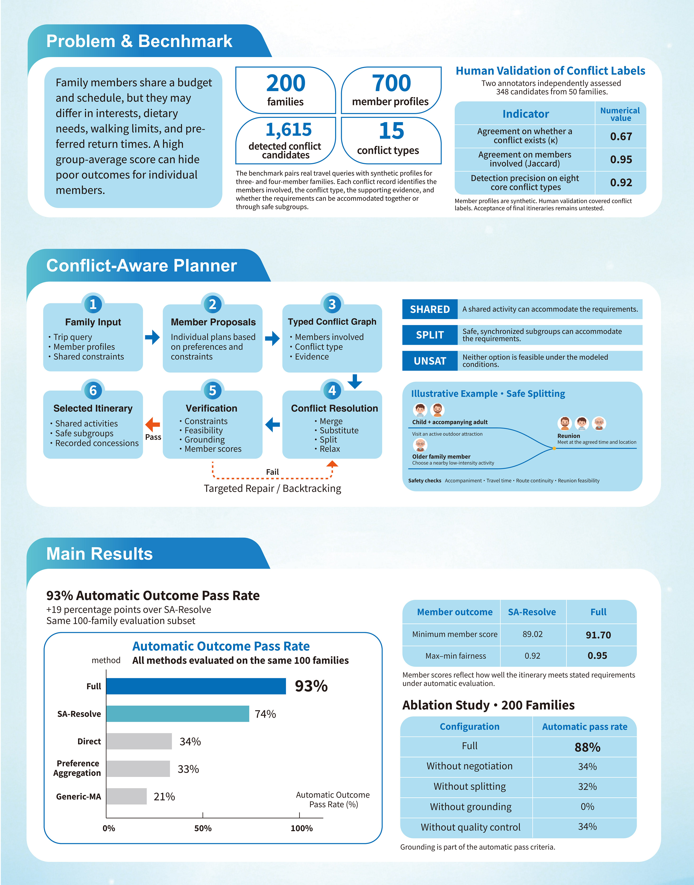

# FamilyTravel: Conflict-Aware Multi-Agent Family Travel Planning

Code release for the paper *["FamilyTravel: A Conflict-Annotated Benchmark and a Conflict-Aware Multi-Agent Planner for Family Travel Planning"](https://doi.org/10.1007/978-981-92-7738-4_26)*  ( DOI: https://doi.org/10.1007/978-981-92-7738-4_26 ) . 

[Download the Paper PDF](https://github.com/weilanQ/FamilyTravel/blob/main/FamilyTravel_Benchmarking%20Member-Attributable%20Conflict%20Resolution%20%20in%20Family%20Travel%20Planning.pdf)

This study focuses on multi-stakeholder interest reconciliation and individual fairness in AI group decision-making. Taking family travel as the research scenario, it investigates how AI can fully address the personalized needs of different members while satisfying shared group constraints. We construct the FamilyTravel benchmark, which includes 200 family tasks, 700 member profiles and 15 types of conflicts, and propose an intelligent decision-making approach that can trace conflict origins, reconciliation strategies and concession bearers. 

Evaluated on the same set of 100 tasks, our method achieves an automated evaluation pass rate of 93%, outperforming the centralized conflict-resolution baseline by 19 percentage points, with simultaneous improvements in the minimum member satisfaction score and fairness metrics. This work translates the question of “how the demands of diverse members are accounted for” into a testable technical problem. It lays a methodological foundation for trustworthy AI that balances solution feasibility, member fairness and process transparency, and offers extended value for interdisciplinary research on intelligent services, group consumption decision-making and fintech within the digital economy.

<p align="center">
  
</p>


## Repository layout

```
baseline/       4 comparison baselines: 2 generation-only anchors (single-agent direct, preference aggregation)
                + 2 budget-matched conflict-RESOLVING baselines (sa_resolve, generic_ma_debate)
data_select/    dataset construction (query filtering, persona generation) and result analysis (ablation/baseline comparison, pass rates)
scripts/        pipeline entry points (main_pipeline.py, run_all_ablations.py) and grounding data helpers
src/            the 7 pipeline modules plus shared infrastructure (config, LLM client, grounding, prompts)
```

## Directory convention

`src/config.py` resolves all paths relative to a **project root one level above this repository**. Clone accordingly:

```
<project-root>/
├── code/       <- this repository
├── data/
│   └── processed/FamilyTravel_Mini.csv   <- the FamilyTravel benchmark personas
└── results/    <- created automatically
```

## Setup

Python 3.10+.

```bash
pip install -r requirements.txt
cp .env.example .env   # then fill in your API keys
```

The pipeline uses two LLM endpoints (defaults: generation = `openai/gpt-4o-mini` via OpenRouter, judge = `deepseek-chat` via DeepSeek) and one search provider for online grounding (`ONLINE_SEARCH_PROVIDER`: `tavily` by default; `google_places`, `serpapi` and `bing` are also supported). See `.env.example` for all keys.

## Running

**Full pipeline** (per-family streaming orchestrator; run scope, concurrency and retries are configured in the `ORCH_*` block at the top of the file, or via env vars such as `ORCH_RUN_MODE`):

```bash
python scripts/main_pipeline.py
```

**Ablations** (full / no_quality_control / no_negotiation / no_split / no_grounding), then the comparison table:

```bash
python scripts/run_all_ablations.py
python data_select/compare_ablations.py
```

**Baselines** and their comparison against the full planner:

```bash
python baseline/run_baselines.py
python data_select/compare_baselines.py
```

**Analysis utilities:** `data_select/compute_pass_rates.py` (two-criterion pass rates), `data_select/budget_feasibility.py` (budget-infeasibility screening), `data_select/aggregate_conflict_typology.py` (conflict typology statistics), `src/field_authenticity.py` (entity-level grounding verification against Google Maps).

**Dataset construction** (only needed to rebuild the benchmark from raw queries):

```bash
python data_select/filter_travel_queries.py
python data_select/generate_personas_api.py
```

## Outputs

Each module writes CSV/JSON under `<project-root>/results/module_<n>/`; final natural-language itineraries are exported to `results/final_itinerary_txt/`. Ablation and baseline runs write to `results/ablation/` and `results/baseline/` respectively.

## Contact

You can contact us via email weilanqian@fudan.edu.cn or lankai.yang@mail.utoronto.ca for any questions.
